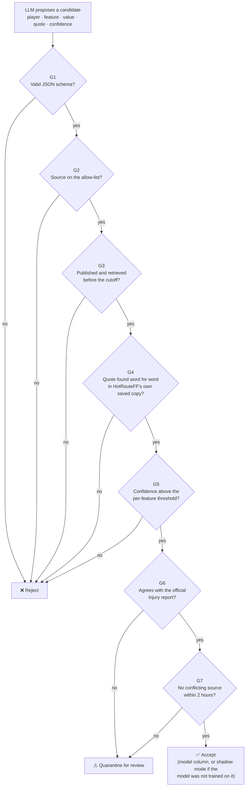

# HotRouteFF Development Blog

**Point-in-time, league-specific, ML-assisted fantasy football analyzer.**

This is the development story of HotRouteFF, my Full Sail University computer science capstone. HotRouteFF predicts whether a player will beat or fall short of the projection on *your* fantasy platform, in *your* league's scoring. It pairs an ONNX machine learning model running in C# .NET 10 with an LLM that reads current news through MCP servers, and it refuses to use any LLM-extracted fact it cannot verify. New posts are added to the top of the list below.

---

## All posts

| # | Date | Post | Topics |
|---|---|---|---|
| 1 | October 23, 2026 | [HotRouteFF: Trust, but Verify — Designing Point-in-Time Guardrails for LLM Features](#post-1-hotrouteff-trust-but-verify) | Design, guardrails, architecture, research, retrospective |

### Browse by topic

- **Architecture:** [REST API + two MCP servers](#3-one-api-two-mcp-servers)
- **LLM features and hallucination guardrails:** [Point-in-time guardrails G1–G7](#1-point-in-time-llm-features-with-guardrails-g1g7)
- **LLM provider choice:** [Provider-agnostic extraction](#2-a-provider-agnostic-llm-layer)
- **Planning and project management:** [The 12-milestone plan](#4-a-12-milestone-plan-on-azure-devops)
- **Data sources and research:** [Milestone 1 research findings](#5-milestone-1-research-what-the-data-sources-actually-allow)
- **Reflection:** [Retrospective](#retrospective)

---

## Post 1: HotRouteFF: Trust, but Verify

### Designing Point-in-Time Guardrails for LLM Features

**Author:** Jonathan Calhoun  
**Date:** October 23, 2026  
**Milestone:** 1 of 12 (research and design)  
**Reading time:** about 8 minutes

**In this post**

- [The problem I set out to solve](#the-problem-i-set-out-to-solve)
- [What I built this month](#what-i-built-this-month)
  - [1. Point-in-time LLM features with guardrails G1–G7](#1-point-in-time-llm-features-with-guardrails-g1g7)
  - [2. A provider-agnostic LLM layer](#2-a-provider-agnostic-llm-layer)
  - [3. One API, two MCP servers](#3-one-api-two-mcp-servers)
  - [4. A 12-milestone plan on Azure DevOps](#4-a-12-milestone-plan-on-azure-devops)
  - [5. Milestone 1 research: what the data sources actually allow](#5-milestone-1-research-what-the-data-sources-actually-allow)
  - [6. A new name: HotRouteFF](#6-a-new-name-hotrouteff)
- [Tools and resources](#tools-and-resources)
- [Challenges](#challenges)
- [Retrospective](#retrospective)
- [What's next](#whats-next)

### The problem I set out to solve

Fantasy football tools are full of AI "insights," but very few of them can tell you *where* a fact came from or *when* it was known. That matters for two reasons. First, LLMs confabulate: a model can confidently report that a player was a full participant in practice when no source said so. Second, if a feature was published after kickoff, any model trained on it is cheating. That is look-ahead leakage, and it quietly inflates accuracy in testing and then falls apart in real use.

So the problem I spent this month on was not "how do I get an LLM to read the news." It was: **how do I let an LLM read the news without ever trusting it?**

> This month was the design and research phase (Milestones 1 and 2 are research only in my plan). Everything below is designed, documented and planned, not yet running code. Production implementation starts with Milestone 3.

### What I built this month

This month I produced the project's foundation documents and the design decisions inside them: a rewritten Requirements Document, a High-Level Design Document (HLDD), a first draft of an IEEE-style research paper, the capstone proposal deck with a system architecture slide, and a Milestone 1 research report. The sections below are the features those documents define and the decisions behind them.

#### 1. Point-in-time LLM features with guardrails G1–G7

This is the core of HotRouteFF and the thing that sets it apart from comparable products like FantasyPros' AI assistant and Fantasy Nerds' coach. It combines two of the three major features:

- **Feature A, point-in-time extraction.** Every feature builder takes an explicit `as_of` cutoff. Only information published *and* retrieved before the cutoff can be used, and every prediction row records `features_as_of_utc` and `built_utc` so you can see exactly how fresh its data was. A replay test will rebuild historical rows "as if live" and must match the training features cell for cell.
- **Feature C, hallucination guardrails.** The LLM only *proposes* candidate features (player, feature, value, source document, an exact quote, and a confidence score). Plain, deterministic C# code then decides. The same input always gets the same decision.

I designed the guardrails as an ordered chain where each rule can accept, reject, or quarantine a candidate for human review:

Accepted features go into an append-only provenance store in SQL Server 2025 with their full trail: source URL, publication and retrieval times, quote, model, and prompt version. Anything quarantined is held out of predictions until an administrator approves or rejects it.

**How I built it:** I wrote the rules first as pseudocode in the HLDD (algorithm A7), then traced each rule back to a system requirement and a use case so every guardrail has a test plan. The design is grounded in published research on data leakage in ML-based science (Kapoor and Narayanan) and on detecting LLM confabulation (Farquhar et al.), which is why verification is done by code instead of by asking the LLM to check itself.

#### 2. A provider-agnostic LLM layer

Early on I had designed around a single LLM vendor. I changed that decision this month: HotRouteFF is now **LLM provider-agnostic**. Extraction goes through an `IExtractionModel` interface built on `Microsoft.Extensions.AI`'s `IChatClient`, so the same code can call a cloud frontier model or a local model served by Ollama, LM Studio, or vLLM.

The reason is simple: because the guardrails verify everything, the LLM is a replaceable part. It also protects the project from price changes and outages. My Milestone 1 research picked a low-cost cloud model on Azure AI Foundry as the primary, a local open-weight model on Ollama as the fallback, and a third provider in reserve. If the provider is rate-limited or down, the build marks that player "structured-only" and keeps going instead of failing.

#### 3. One API, two MCP servers

The proposal's architecture slide pulled the whole design together. One ASP.NET Core (.NET 10) API container hosts the web app, a REST API, and two MCP servers, and all of them call the same `PredictionService`. That way the web page, a developer's script, and an AI agent always get the same answer for the same player.

The **Inference MCP server** exposes the ONNX model as MCP tools so any AI agent can ask for a calibrated prediction. The **News MCP server** is the only way the extraction agent can reach the internet, and it only fetches allow-listed sites, so the LLM cannot cite a random blog or an invented URL. The model itself is trained in Python (LightGBM) and exported to ONNX, with a planned Python-to-C# parity check within 1e-4.

#### 4. A 12-milestone plan on Azure DevOps

I rebuilt the roadmap from four three-week milestones into **12 one-week milestones** (October 12, 2026 to January 3, 2027):

| Milestones | Focus |
|---|---|
| 1–2 | Research and design, no code |
| 3–10 | Implementation, tasks T1–T39 |
| 11–12 | Defense documentation and planning |

The plan totals about 332 base hours (365 hours with a 10% buffer). I mirrored it in Azure DevOps Boards with one iteration and one epic per milestone, and every task re-parented under its milestone's epic, so the board and the HLDD's Gantt chart tell the same story. CI will run on Azure Pipelines.

#### 5. Milestone 1 research: what the data sources actually allow

The Milestone 1 research report (competitor teardown, data-source due diligence, LLM and hosting options) changed the design in several concrete ways:

- **`nfl_data_py` was archived in September 2025.** The Python data layer will use its successor, `nflreadpy`.
- **Schedule betting lines are a leakage trap.** The spread and total in nflverse schedules keep being overwritten until kickoff, so they cannot be used as "what was known 24 hours before."
- **Historical weather is not historical forecasts.** Open-Meteo's Historical Forecast API is stitched from near-analysis data, not the forecast that was actually issued. For point-in-time correctness I will use its Previous Runs API instead.
- **The Odds API free plan has no history.** On 500 credits a month, Feature B (recalibration against prop lines) only gets live data from this season forward, which shapes how much I can claim about it.
- **Not every news site allows AI retrieval.** Some sites' robots.txt files or terms forbid automated or AI access, so the allow-list records each source's terms and only includes sources that permit this use.
- **My token budget was wrong.** The HLDD's 400k tokens-per-run cap is too low for the Sunday early window (about 730k estimated), so that limit needs revising before implementation.

#### 6. A new name: HotRouteFF

Midway through the month I renamed the project from HotRoute to **HotRouteFF** to make the fantasy football focus clear. That meant updating the Requirements Document, HLDD, paper, proposal, slides, SWOT and Business Model Canvas, and re-rendering the diagrams and wireframes. It was tedious, but doing it in Milestone 1 is far cheaper than doing it after code exists.

### Tools and resources

| Category | What I used |
|---|---|
| Planned stack | C# / .NET 10, ASP.NET Core, Blazor, ONNX Runtime, Microsoft.Extensions.AI, Model Context Protocol (MCP), SQL Server 2025, Python with LightGBM and `nflreadpy` |
| Project management | Azure DevOps Boards (12 iterations, one epic per milestone), Azure Pipelines for CI |
| Documents and diagrams | Microsoft Word templates from my program, Python scripts (python-docx, matplotlib) for diagrams, HTML mockups captured with Playwright for wireframes |
| Assistance | An AI assistant for drafting, research legwork and document generation, with every design decision made and reviewed by me |
| Key references | Kapoor & Narayanan on leakage in ML-based science; Farquhar et al. on detecting LLM confabulation; Ke et al. (LightGBM); Grinsztajn et al. on tree models for tabular data; the ONNX Runtime and MCP documentation; nflverse, Open-Meteo and The Odds API documentation |

All academic sources in my documents use IEEE citations and are free to read (no paywalled sources).

### Challenges

- **Scope creep in the research questions.** My paper draft originally had a fourth research question about user trust, which would have required a human-subjects study. I cut it. Trust in HotRouteFF is now defined as provenance and verifiability, which I can actually measure.
- **Free-tier limits.** Staying on The Odds API's free plan keeps costs at zero but limits the recalibration sample. That is a trade-off I am choosing deliberately and will document.

### Retrospective

**What went well**

- **Design before code paid off.** Writing the guardrails as pseudocode and tracing them to requirements exposed problems (the token budget, the leakage traps) while they were still cheap to fix.
- **Decisions are written down.** Every major call this month (provider-agnostic LLM, SQL Server for provenance, free-tier odds data, dropping the trust study) is recorded in the HLDD or project notes with its reason.
- **The board matches the plan.** Re-structuring Azure DevOps to 12 milestones means progress is visible week by week.

**What did not go well**

- **Too much rework.** The roadmap changed shape twice (four milestones, then twelve) and the product was renamed mid-month. Each change rippled through five or more documents.
- **Versions piled up.** I ended up with several copies of the HLDD (dark UI, fixed, LLM-agnostic, 12 milestones). I need one clearly named current version.

**What I will do differently in November**

1. Lock the naming and milestone structure: no more structural changes without a strong reason.
2. Keep one "current" copy of each document and archive older versions in a separate folder.
3. Start Milestone 3 by writing tests first for the point-in-time rule and each guardrail (one passing and one failing fixture per rule), since those are the claims the whole project rests on.

**How I rate the month:** strong on design and research, weaker on focus. I spent more time re-formatting documents than I would like, but I am starting implementation with a design I can defend.

### What's next

Milestone 3 Implementation!

---

*HotRouteFF is an informational tool. It does not take, place or link to wagers.*
