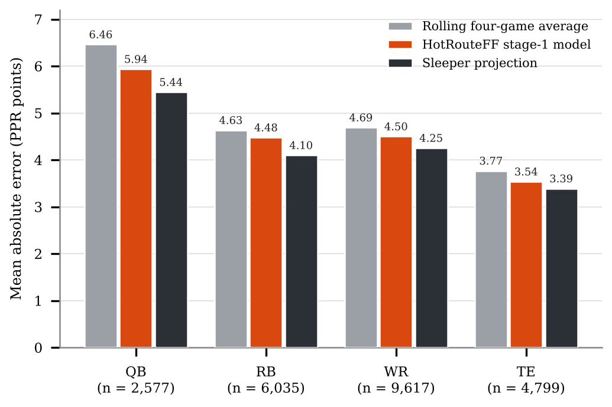
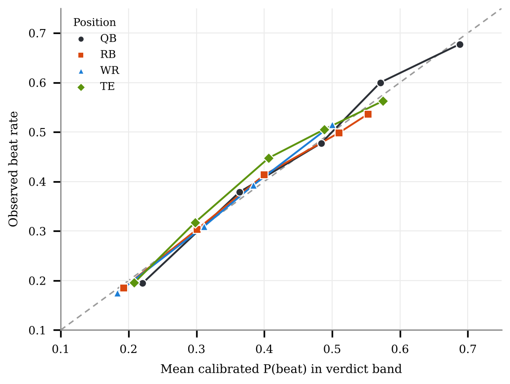
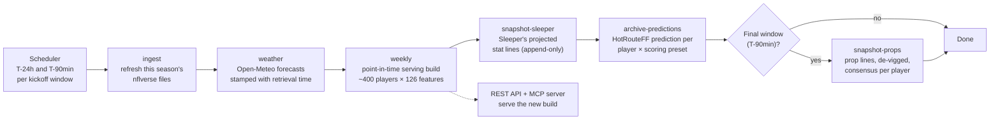
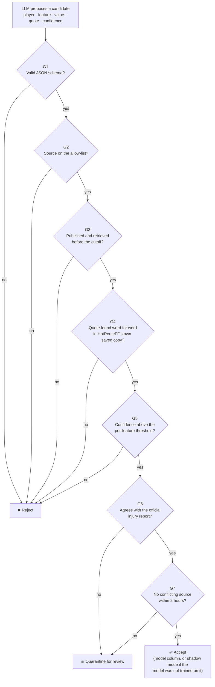

# HotRouteFF Development Blog

**Point-in-time, league-specific, ML-assisted fantasy football analyzer.**

This is the development story of HotRouteFF, my Full Sail University computer science capstone. HotRouteFF predicts whether a player will beat or fall short of the projection on *your* fantasy platform, in *your* league's scoring. It pairs an ONNX machine learning model running in C# .NET 10 with an LLM that reads current news through MCP servers, and it refuses to use any LLM-extracted fact it cannot verify. New posts are added to the top of the list below.

---

## All posts

| # | Date | Post | Topics |
|---|---|---|---|
| 2 | November 22, 2026 | [HotRouteFF: From Blueprint to Live Sunday — Building the Point-in-Time Prediction Pipeline, End to End](#post-2-hotrouteff-from-blueprint-to-live-sunday) | Implementation, ML models, ONNX, REST API, MCP, live capture, profiling, retrospective |
| 1 | October 23, 2026 | [HotRouteFF: Trust, but Verify — Designing Point-in-Time Guardrails for LLM Features](#post-1-hotrouteff-trust-but-verify) | Design, guardrails, architecture, research, retrospective |

### Browse by topic

- **Architecture and serving:** [REST API + two MCP servers (design)](#3-one-api-two-mcp-servers) · [ONNX, scoring and the REST API (built)](#4-from-python-to-c-onnx-scoring-and-the-rest-api-milestones-4-and-5) · [Inference MCP server and live capture](#5-the-inference-mcp-server-and-the-first-live-sunday-milestone-6)
- **Point-in-time correctness and leakage:** [Guardrails G1–G7 (design)](#1-point-in-time-llm-features-with-guardrails-g1g7) · [126 features and leakage tests](#2-126-point-in-time-features-and-the-tests-that-guard-them-milestones-3-and-4)
- **Machine learning and calibration:** [Two-stage model and calibrated P(beat)](#3-a-two-stage-model-with-calibrated-probabilities-milestone-4)
- **Data sources:** [Milestone 1 research findings](#5-milestone-1-research-what-the-data-sources-actually-allow) · [Shared contracts and pinned data](#1-shared-contracts-and-pinned-data-milestone-3)
- **LLM provider choice:** [Provider-agnostic extraction](#2-a-provider-agnostic-llm-layer)
- **Performance:** [CPU profiling](#6-profiling-60-threads-spinning-for-nothing)
- **Research design:** [Sharpening the research design](#7-sharpening-the-research-design)
- **Planning and project management:** [The 12-milestone plan](#4-a-12-milestone-plan-on-azure-devops)
- **Reflection:** [October retrospective](#retrospective) · [November retrospective](#november-retrospective)

## Post 2: HotRouteFF: From Blueprint to Live Sunday

### Building the Point-in-Time Prediction Pipeline, End to End

**Author:** Jonathan Calhoun  
**Date:** November 22, 2026  
**Milestones:** 2 through 6 of 12 (October 19 to November 22)  
**Reading time:** about 12 minutes

**In this post**

- [Where I left off](#where-i-left-off)
- [What I built from October 23 to November 22](#what-i-built-from-october-23-to-november-22)
  - [1. Shared contracts and pinned data (Milestone 3)](#1-shared-contracts-and-pinned-data-milestone-3)
  - [2. 126 point-in-time features and the tests that guard them (Milestones 3 and 4)](#2-126-point-in-time-features-and-the-tests-that-guard-them-milestones-3-and-4)
  - [3. A two-stage model with calibrated probabilities (Milestone 4)](#3-a-two-stage-model-with-calibrated-probabilities-milestone-4)
  - [4. From Python to C#: ONNX, scoring and the REST API (Milestones 4 and 5)](#4-from-python-to-c-onnx-scoring-and-the-rest-api-milestones-4-and-5)
  - [5. The Inference MCP server and the first live Sunday (Milestone 6)](#5-the-inference-mcp-server-and-the-first-live-sunday-milestone-6)
  - [6. Profiling: 60 threads spinning for nothing](#6-profiling-60-threads-spinning-for-nothing)
  - [7. Sharpening the research design](#7-sharpening-the-research-design)
- [Tools and resources used this month](#tools-and-resources-used-this-month)
- [Challenges this month](#challenges-this-month)
- [November retrospective](#november-retrospective)
- [What's next after Milestone 6](#whats-next-after-milestone-6)

### Where I left off

My last post ended with the design finished and one line under "What's next": *Milestone 3 implementation!* This month that design became software. Between October 23 and November 22 I merged 21 pull requests into the production repository. HotRouteFF can now build point-in-time features for every active quarterback, running back, wide receiver and tight end, predict a full stat line with an ONNX model in C#, score it in a real Sleeper, ESPN or Yahoo league, and serve it over REST and MCP. On Sunday, November 22, it captured its first live NFL week.

> **What is not built yet:** the LLM side, which is Feature A's news extraction and the G1–G7 guardrails from my last post, is still ahead in the roadmap. Everything in this post is the structured-data model it will plug into. No research question has been answered yet. The numbers below describe the baseline, not a test of any hypothesis.

### What I built from October 23 to November 22

#### 1. Shared contracts and pinned data (Milestone 3)

Python trains the model and C# serves it, so the first job was to make the two languages agree on everything. I wrote shared JSON contracts that both sides load and validate:

- **`canonical_stats.json`** fixes the order of the **21 statistics** HotRouteFF predicts (passing, rushing, receiving, turnovers and touchdowns). It started at 20. I added a special-teams touchdown stat in version 2, because without it the scoring presets could not reproduce official fantasy points exactly.
- **`scoring_presets.json`** defines the Standard, Half-PPR and PPR reference leagues used in testing and evaluation.
- A **feature manifest** and a **calibration schema** define exactly what the model export must write.

Data comes from **nflverse** through `nflreadpy`, from 2016 to the present. nflverse overwrites its release files in place, so I added a lock file that pins every downloaded file with its release date and SHA-256 digest. If an upstream file changes, ingestion stops until I re-pin it on purpose. Weather comes from **Open-Meteo**. For games from 2022 on, it uses historical *forecasts*, meaning what was predicted before kickoff rather than what actually happened. Seasons before 2022 use observed weather, and that is a documented exception to the leakage rule.

#### 2. 126 point-in-time features and the tests that guard them (Milestones 3 and 4)

The feature builder writes one row per player-week as of **kickoff minus 90 minutes**. Each row has **126 features in nine groups**: usage (20), production (63), game context (6), offensive scheme (12), defensive scheme (10), coaching tendency (3), weather (7), injury (3) and interactions (2).

Every group reads its sources through a single backward as-of join. That join only accepts rows whose *availability time* is at or before the cutoff. I had to write down when each kind of data actually becomes known:

| Source | Counts as known from |
|---|---|
| Box scores, snaps, play-by-play | 12 hours after that game's kickoff |
| Schedule facts | May 1 of the season |
| Injury reports | Their last-modified time |
| Weather forecasts | The time I retrieved them |

Then I wrote the **leakage and replay tests**, which make the point-in-time promise from my first post executable:

- An input published **one minute after the cutoff** is reported as leaking, even though it is still before kickoff.
- A column injected with a post-kickoff timestamp is caught.
- Observed weather is allowed only before 2022. The same value in a 2022 row fails.
- A **replay test** rebuilds historical rows "as if live" and compares them with the training features, reporting every cell that differs.

#### 3. A two-stage model with calibrated probabilities (Milestone 4)

- **Stage 1** fits one **LightGBM** model per position and statistic to predict the stat line: a Poisson objective for counts such as touchdowns, and squared error for yardage. League scoring is then applied as weights (`points = stats × weights`), so one model serves every league.
- **Stage 2** predicts **11 quantiles** of fantasy points (from the 5th to the 95th percentile) and turns them into **P(beat)**, the probability that a player beats a given projection. **Isotonic calibration** then corrects that probability so that "60%" really means about 60%.

All evaluation is walk-forward: each test season is predicted only by models trained on earlier seasons. On out-of-fold 2022–2025 player-weeks in PPR scoring, the stage-1 model has lower error than a rolling four-game average at every position. Sleeper's own projections, which use news the model can't see yet, are lower still. That gap is exactly what Feature A is meant to narrow, and the comparison is descriptive only.

*Figure 1. Mean absolute error of fantasy points (PPR), out-of-fold 2022–2025, on player-weeks that have an archived Sleeper projection.*

Accuracy is only half the goal. The probabilities also have to be honest. Calibrated P(beat) has **positive Brier skill at every position**. Isotonic calibration roughly **halves the expected calibration error (ECE)** for quarterbacks, running backs and wide receivers, and the 80% prediction intervals cover **78.9% to 80.3%** of actual outcomes.

| Position | Player-weeks | MAE, rolling avg | MAE, model | Brier skill | ECE raw → calibrated | 80% interval coverage |
|---|---|---|---|---|---|---|
| QB | 2,694 | 6.48 | 5.94 | 0.115 | 0.029 → 0.015 | 78.9% |
| RB | 6,317 | 4.62 | 4.47 | 0.048 | 0.039 → 0.016 | 79.8% |
| WR | 10,106 | 4.70 | 4.50 | 0.048 | 0.046 → 0.019 | 80.3% |
| TE | 5,026 | 3.78 | 3.55 | 0.068 | 0.036 → 0.030 | 80.2% |

*Figure 2. Reliability diagram: observed beat rate against mean calibrated P(beat) for each verdict band, out-of-fold 2022–2025. The closer a line sits to the dashed diagonal, the more honest the probability.*

#### 4. From Python to C#: ONNX, scoring and the REST API (Milestones 4 and 5)

I exported **one ONNX graph per position**, with three inputs: the features, the league's scoring weights, and the player's recent history. Parity tests check that all 40 "golden" rows give the same output in C# as in Python, **within 1e-4**. The models are published as a versioned **Universal Package in Azure Artifacts**, so CI downloads them and runs the golden tests on every build.

The serving side in **C# .NET 10**:

- **SQL Server, not SQLite.** My design document had planned a SQLite file for serving rows. I changed that to one SQL Server database with two schemas (`serving` and `provenance`), created by EF Core migrations. It runs in Docker locally and targets Azure SQL for hosting. The API refuses to start if the manifest, models and database disagree, and its log line names the mismatched feature.
- **Scoring engine and platform adapters.** These turn a Sleeper, ESPN or Yahoo league's settings into weights over the 21 stats, plus threshold bonuses. Re-scoring every 2025 player-week (6,321 of them) with the three presets reproduces official fantasy points with an **MAE of 0.00**. No scoring rule is dropped silently. Rules the engine cannot score are listed with a reason.
- **PredictionService** combines everything into one answer: projected points, quantiles, an 80% range, raw and calibrated P(beat), and a verdict band (from StrongUnder to StrongOver) measured against each position's base rate. Every answer is stamped with its `featuresAsOfUtc`, model version and calibration version.
- **REST API.** OpenAPI 3.1, RFC 9457 problem details, and a batch endpoint for up to 100 players. Platform credentials come only from request headers, are never stored, and are redacted from logs. A test sends distinctive fake secrets through every route and proves that none of them appears in any log line or response.

#### 5. The Inference MCP server and the first live Sunday (Milestone 6)

The **Inference MCP server** went live over both Streamable HTTP and stdio, inside the same Docker container as the REST API. Any MCP-capable AI client can now call a `predict_player` tool and get the same answer the REST API returns. I tested it with a small local model running in Ollama through an open-source coding agent. With a 4-billion-parameter model, spelling out the tool arguments explicitly works best.

Then I built the live capture pipeline. A scheduler container runs a job **24 hours** and again **90 minutes** before each kickoff window:

*Figure 3. The live capture job. Every artifact is timestamped before kickoff, so Milestone 7 can score HotRouteFF, Sleeper and the prop markets against the same results.*

A few design details:

- The **prediction archive** is append-only. The database rejects updates and deletes, and a row is written only once per player, game, scoring preset, cutoff and model.
- **Prop lines** come from The Odds API's free plan (500 credits a month). Each capture costs 4 credits per game, converts every bookmaker's price to a de-vigged probability, and is skipped if it would leave fewer than 60 credits.
- A new `serving.Players` table makes it easy to join player IDs to names in SQL.

**The first live week (NFL week 11).** All four Saturday jobs ran cleanly, each archiving about 1,100 to 1,200 predictions and about 1,778 Sleeper projections. By Sunday afternoon the archive held **5,661 pre-kickoff predictions** and **237 consensus prop lines from 7 games**, with 468 Odds API credits left.

#### 6. Profiling: 60 threads spinning for nothing

For a performance assignment I profiled the API's CPU across startup, model loading, prediction load and idle. One problem stood out. By default, **ONNX Runtime gave each of the four position models its own 15-thread pool**, and those threads spun after every tiny tree-model prediction. One single-player prediction cost about **164 ms of CPU**.

I made three fixes:

1. Each ONNX session runs on the request's own thread with spinning turned off.
2. The 100-player batch endpoint reads every player in **one SQL query** instead of about 300.
3. Batches run **one model call per position** instead of one per player.

In my measurements, single predictions went from **69 to 981 per second** at about 2 ms of CPU each, and a 100-player batch went from **1.4 s to 38 ms**. Those runs overlapped a GPU training job on the same PC, so I'm treating the absolute numbers as provisional until I re-run them on an idle machine. The before-and-after comparison ran under the same conditions, though, so the improvement itself is real. An earlier in-process latency benchmark had already shown a prediction p95 of about 2.5 ms against my 200 ms target.

#### 7. Sharpening the research design

Writing the implementation section of my IEEE paper forced me to tighten the research design, and on November 4 I reframed it:

- Every hypothesis is now tested against a **neutral reference projection**: the player's rolling four-game average. Comparisons with Sleeper or prop lines are reported as descriptive only, because platform projections change in ways I can't control.
- **RQ1, now the central question:** does weekly recalibration, promoted only when held-out Brier score improves, beat a frozen calibration on a week-by-week replay of the 2025 season?
- **RQ2** (do guardrail-verified LLM features help?) waits on Feature A. **RQ3** measures guardrail precision.

The paper gained a full **Implementation** section with the pipeline figure, the baseline metrics above, and a table that maps milestones to work items and pull requests. I also wrote a **usability test plan**: a pilot, then think-aloud sessions on clickable wireframes and later on the live app, scored with task success, SEQ and SUS. I prepared an informed consent form and a recruitment ad for a short survey of fantasy managers.

### Tools and resources used this month

| Category | What I used |
|---|---|
| Machine learning | Python 3.11 with uv, pandas, LightGBM, scikit-learn (isotonic regression), ONNX and onnxmltools, mssql-python, pytest |
| Serving | C# / .NET 10, ASP.NET Core minimal APIs with OpenAPI, ONNX Runtime, EF Core 10, the C# Model Context Protocol SDK (Streamable HTTP and stdio), Microsoft.Extensions.Http.Resilience, xUnit v3 |
| Data | nflverse via `nflreadpy`, Open-Meteo, the Sleeper, ESPN and Yahoo fantasy APIs, The Odds API (free plan) |
| Infrastructure | SQL Server in Docker (Azure SQL as the target), Docker Compose, Azure Pipelines on a self-hosted agent container, an Azure Artifacts feed for models |
| Tooling | Visual Studio Performance Profiler, Azure DevOps Boards and pull requests |
| Assistance | An AI assistant for drafting, code generation, test writing and research legwork. I reviewed every change, made every design decision, and did every push and merge myself |
| Key references | Kapoor & Narayanan on leakage in ML-based science; Ke et al. on LightGBM; Silva Filho et al. on classifier calibration; Dimitriadis et al. on reliability diagrams; the ONNX Runtime threading documentation |

### Challenges this month

- **A bug the rehearsal caught.** The day before the first live week, a dry run showed that the scheduler's refresh step rebuilt the history tables from **2026 games only**. Every live prediction would have lost its long-term history. I fixed it so the refresh keeps every season and re-downloads only the current one, then rebuilt the tables. Rehearsing before going live paid for itself.
- **Yahoo said no.** Yahoo's Fantasy API returned "application not authorized" to two separate developer apps, even with valid OAuth tokens. The Yahoo adapter is tested against Yahoo's documented format, and the real-league test stays marked as pending.
- **Custom scoring needs custom history.** Running my own Sleeper league on Josh Allen showed a projection of 27.1 points, slightly below Sleeper's 27.23, yet a "StrongUnder" verdict. The cause was real: my league gives 6 points per passing touchdown, but the history input for custom leagues borrows the nearest preset (Half-PPR, with 4 points per passing touchdown), which pulls the distribution down. The API flags this with a warning. The fix, history computed under each league's own weights, is next on my list.
- **Near-zero projections skew the verdicts.** In the first live run, most "StrongOver" calls were backups that Sleeper projected under 1 point. For players Sleeper projects at 8 or more points, the model is actually about 1.1 points *under* Sleeper on average. Milestone 7's analysis will report those groups separately.
- **The data moved under me.** nflverse revised 2026 play-by-play after I built my training features, so the week 7 replay test now fails by design until the next feature rebuild. The lock file is the reason I noticed.
- **A merge dropped code.** One pull request merge silently lost the MCP server's wiring, and I had to restore it in a follow-up. Since then I check the merged result, not just the branch.
- **Documents drifting from code.** My design document still described SQLite after I switched to SQL Server. Keeping the paper, the HLDD and the code in sync is ongoing work.

### November retrospective

**What went well**

- **Tests first held up.** I promised in October to start with tests for the point-in-time rule, and I did. The leakage suite, the golden ONNX rows, the MAE 0.00 scoring check and the redaction test each turned a claim into something CI checks on every build.
- **Steady cadence.** Five one-week milestones in a row, each closed with merged pull requests and a short summary. My plan's weekly structure worked.
- **Contracts between languages.** Making Python and C# load the same JSON contracts meant the ONNX hand-off worked on the first export, with parity within 1e-4.
- **Measuring before optimizing.** The profiler found a real 76× CPU problem I would never have guessed.

**What did not go well**

- **The LLM features slipped.** Feature A and the guardrails, the parts that make HotRouteFF different, are still ahead of me, while the structured pipeline took the whole month. RQ2 now depends on how quickly I can build them.
- **Too many open threads at once.** Live capture, profiling, the paper and the usability plan all landed in the same week, and I left several feature branches unmerged at the same time.
- **Environment-dependent numbers.** I ran the profiling while my GPU was training, so I now have to re-measure. Benchmarks need a quiet machine.

**What I will do differently in December**

1. Merge one branch before starting the next one, and keep `main` releasable.
2. Re-run the profiler on an idle machine, in a Release build, before reporting final numbers.
3. Start Feature A on the guardrails' tests (one passing and one failing fixture per rule) before writing any LLM prompt.
4. Update the design document whenever a decision changes, not at the end.

**How I rate the month:** a big step forward. At the start of the month HotRouteFF was a document. Now it makes calibrated, timestamped predictions in real leagues and has a live week on record. The risk has moved from "can I build it?" to "can I finish the LLM side in time to measure it?"

### What's next after Milestone 6

- **Milestone 7:** score week 11 against actual results (HotRouteFF vs. Sleeper vs. the prop markets), build the weekly recalibration job with its promotion gate, and add per-league history so custom-scoring leagues no longer use an approximation.
- **Feature A:** the News MCP server, the extraction agent behind `IExtractionModel`, and the G1–G7 guardrail chain.
- **Usability:** run the pilot session on the clickable wireframes.

---

## Post 1: HotRouteFF: Trust, but Verify

### Designing Point-in-Time Guardrails for LLM Features

**Author:** Jonathan Calhoun  
**Date:** October 23, 2026  
**Milestone:** 1 of 12 (research and design)  
**Reading time:** about 8 minutes

**In this post**

- [The problem I set out to solve](#the-problem-i-set-out-to-solve)
- [What I built this month](#what-i-built-this-month)
  - [1. Point-in-time LLM features with guardrails G1–G7](#1-point-in-time-llm-features-with-guardrails-g1g7)
  - [2. A provider-agnostic LLM layer](#2-a-provider-agnostic-llm-layer)
  - [3. One API, two MCP servers](#3-one-api-two-mcp-servers)
  - [4. A 12-milestone plan on Azure DevOps](#4-a-12-milestone-plan-on-azure-devops)
  - [5. Milestone 1 research: what the data sources actually allow](#5-milestone-1-research-what-the-data-sources-actually-allow)
  - [6. A new name: HotRouteFF](#6-a-new-name-hotrouteff)
- [Tools and resources](#tools-and-resources)
- [Challenges](#challenges)
- [Retrospective](#retrospective)
- [What's next](#whats-next)

### The problem I set out to solve

Fantasy football tools are full of AI "insights," but very few of them can tell you *where* a fact came from or *when* it was known. That matters for two reasons. First, LLMs confabulate: a model can confidently report that a player was a full participant in practice when no source said so. Second, if a feature was published after kickoff, any model trained on it is cheating. That is look-ahead leakage, and it quietly inflates accuracy in testing and then falls apart in real use.

So the problem I spent this month on was not "how do I get an LLM to read the news." It was: **how do I let an LLM read the news without ever trusting it?**

> This month was the design and research phase (Milestones 1 and 2 are research only in my plan). Everything below is designed, documented and planned, not yet running code. Production implementation starts with Milestone 3.

### What I built this month

This month I produced the project's foundation documents and the design decisions inside them: a rewritten Requirements Document, a High-Level Design Document (HLDD), a first draft of an IEEE-style research paper, the capstone proposal deck with a system architecture slide, and a Milestone 1 research report. The sections below are the features those documents define and the decisions behind them.

#### 1. Point-in-time LLM features with guardrails G1–G7

This is the core of HotRouteFF and the thing that sets it apart from comparable products like FantasyPros' AI assistant and Fantasy Nerds' coach. It combines two of the three major features:

- **Feature A, point-in-time extraction.** Every feature builder takes an explicit `as_of` cutoff. Only information published *and* retrieved before the cutoff can be used, and every prediction row records `features_as_of_utc` and `built_utc` so you can see exactly how fresh its data was. A replay test will rebuild historical rows "as if live" and must match the training features cell for cell.
- **Feature C, hallucination guardrails.** The LLM only *proposes* candidate features (player, feature, value, source document, an exact quote, and a confidence score). Plain, deterministic C# code then decides. The same input always gets the same decision.

I designed the guardrails as an ordered chain where each rule can accept, reject, or quarantine a candidate for human review:

Accepted features go into an append-only provenance store in SQL Server 2025 with their full trail: source URL, publication and retrieval times, quote, model, and prompt version. Anything quarantined is held out of predictions until an administrator approves or rejects it.

**How I built it:** I wrote the rules first as pseudocode in the HLDD (algorithm A7), then traced each rule back to a system requirement and a use case so every guardrail has a test plan. The design is grounded in published research on data leakage in ML-based science (Kapoor and Narayanan) and on detecting LLM confabulation (Farquhar et al.), which is why verification is done by code instead of by asking the LLM to check itself.

#### 2. A provider-agnostic LLM layer

Early on I had designed around a single LLM vendor. I changed that decision this month: HotRouteFF is now **LLM provider-agnostic**. Extraction goes through an `IExtractionModel` interface built on `Microsoft.Extensions.AI`'s `IChatClient`, so the same code can call a cloud frontier model or a local model served by Ollama, LM Studio, or vLLM.

The reason is simple: because the guardrails verify everything, the LLM is a replaceable part. It also protects the project from price changes and outages. My Milestone 1 research picked a low-cost cloud model on Azure AI Foundry as the primary, a local open-weight model on Ollama as the fallback, and a third provider in reserve. If the provider is rate-limited or down, the build marks that player "structured-only" and keeps going instead of failing.

#### 3. One API, two MCP servers

The proposal's architecture slide pulled the whole design together. One ASP.NET Core (.NET 10) API container hosts the web app, a REST API, and two MCP servers, and all of them call the same `PredictionService`. That way the web page, a developer's script, and an AI agent always get the same answer for the same player.

The **Inference MCP server** exposes the ONNX model as MCP tools so any AI agent can ask for a calibrated prediction. The **News MCP server** is the only way the extraction agent can reach the internet, and it only fetches allow-listed sites, so the LLM cannot cite a random blog or an invented URL. The model itself is trained in Python (LightGBM) and exported to ONNX, with a planned Python-to-C# parity check within 1e-4.

#### 4. A 12-milestone plan on Azure DevOps

I rebuilt the roadmap from four three-week milestones into **12 one-week milestones** (October 12, 2026 to January 3, 2027):

| Milestones | Focus |
|---|---|
| 1–2 | Research and design, no code |
| 3–10 | Implementation, tasks T1–T39 |
| 11–12 | Defense documentation and planning |

The plan totals about 332 base hours (365 hours with a 10% buffer). I mirrored it in Azure DevOps Boards with one iteration and one epic per milestone, and every task re-parented under its milestone's epic, so the board and the HLDD's Gantt chart tell the same story. CI will run on Azure Pipelines.

#### 5. Milestone 1 research: what the data sources actually allow

The Milestone 1 research report (competitor teardown, data-source due diligence, LLM and hosting options) changed the design in several concrete ways:

- **`nfl_data_py` was archived in September 2025.** The Python data layer will use its successor, `nflreadpy`.
- **Schedule betting lines are a leakage trap.** The spread and total in nflverse schedules keep being overwritten until kickoff, so they cannot be used as "what was known 24 hours before."
- **Historical weather is not historical forecasts.** Open-Meteo's Historical Forecast API is stitched from near-analysis data, not the forecast that was actually issued. For point-in-time correctness I will use its Previous Runs API instead.
- **The Odds API free plan has no history.** On 500 credits a month, Feature B (recalibration against prop lines) only gets live data from this season forward, which shapes how much I can claim about it.
- **Not every news site allows AI retrieval.** Some sites' robots.txt files or terms forbid automated or AI access, so the allow-list records each source's terms and only includes sources that permit this use.
- **My token budget was wrong.** The HLDD's 400k tokens-per-run cap is too low for the Sunday early window (about 730k estimated), so that limit needs revising before implementation.

#### 6. A new name: HotRouteFF

Midway through the month I renamed the project from HotRoute to **HotRouteFF** to make the fantasy football focus clear. That meant updating the Requirements Document, HLDD, paper, proposal, slides, SWOT and Business Model Canvas, and re-rendering the diagrams and wireframes. It was tedious, but doing it in Milestone 1 is far cheaper than doing it after code exists.

### Tools and resources

| Category | What I used |
|---|---|
| Planned stack | C# / .NET 10, ASP.NET Core, Blazor, ONNX Runtime, Microsoft.Extensions.AI, Model Context Protocol (MCP), SQL Server 2025, Python with LightGBM and `nflreadpy` |
| Project management | Azure DevOps Boards (12 iterations, one epic per milestone), Azure Pipelines for CI |
| Documents and diagrams | Microsoft Word templates from my program, Python scripts (python-docx, matplotlib) for diagrams, HTML mockups captured with Playwright for wireframes |
| Assistance | An AI assistant for drafting, research legwork and document generation, with every design decision made and reviewed by me |
| Key references | Kapoor & Narayanan on leakage in ML-based science; Farquhar et al. on detecting LLM confabulation; Ke et al. (LightGBM); Grinsztajn et al. on tree models for tabular data; the ONNX Runtime and MCP documentation; nflverse, Open-Meteo and The Odds API documentation |

All academic sources in my documents use IEEE citations and are free to read (no paywalled sources).

### Challenges

- **Scope creep in the research questions.** My paper draft originally had a fourth research question about user trust, which would have required a human-subjects study. I cut it. Trust in HotRouteFF is now defined as provenance and verifiability, which I can actually measure.
- **Free-tier limits.** Staying on The Odds API's free plan keeps costs at zero but limits the recalibration sample. That is a trade-off I am choosing deliberately and will document.

### Retrospective

**What went well**

- **Design before code paid off.** Writing the guardrails as pseudocode and tracing them to requirements exposed problems (the token budget, the leakage traps) while they were still cheap to fix.
- **Decisions are written down.** Every major call this month (provider-agnostic LLM, SQL Server for provenance, free-tier odds data, dropping the trust study) is recorded in the HLDD or project notes with its reason.
- **The board matches the plan.** Re-structuring Azure DevOps to 12 milestones means progress is visible week by week.

**What did not go well**

- **Too much rework.** The roadmap changed shape twice (four milestones, then twelve) and the product was renamed mid-month. Each change rippled through five or more documents.
- **Versions piled up.** I ended up with several copies of the HLDD (dark UI, fixed, LLM-agnostic, 12 milestones). I need one clearly named current version.

**What I will do differently in November**

1. Lock the naming and milestone structure: no more structural changes without a strong reason.
2. Keep one "current" copy of each document and archive older versions in a separate folder.
3. Start Milestone 3 by writing tests first for the point-in-time rule and each guardrail (one passing and one failing fixture per rule), since those are the claims the whole project rests on.

**How I rate the month:** strong on design and research, weaker on focus. I spent more time re-formatting documents than I would like, but I am starting implementation with a design I can defend.

### What's next

Milestone 3 Implementation!

---

*HotRouteFF is an informational tool. It does not take, place or link to wagers.*
